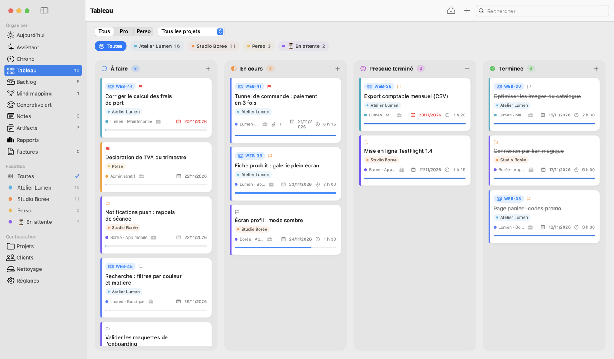
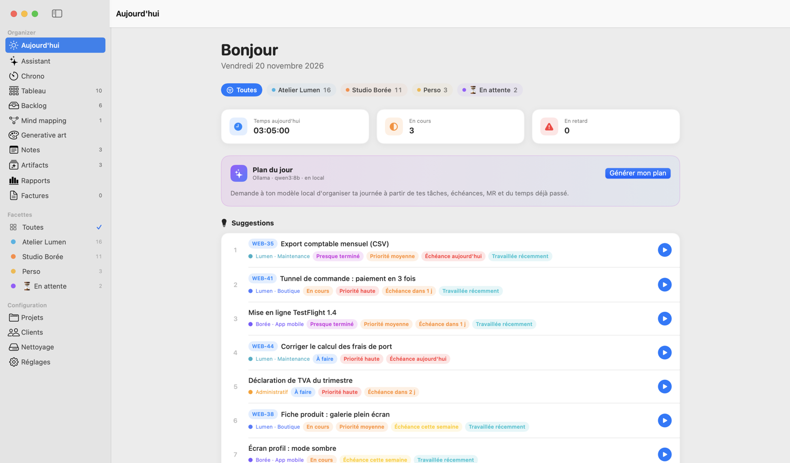
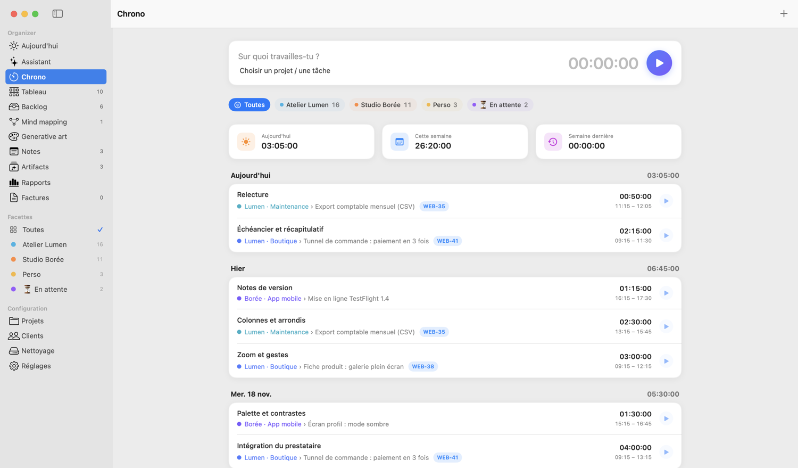
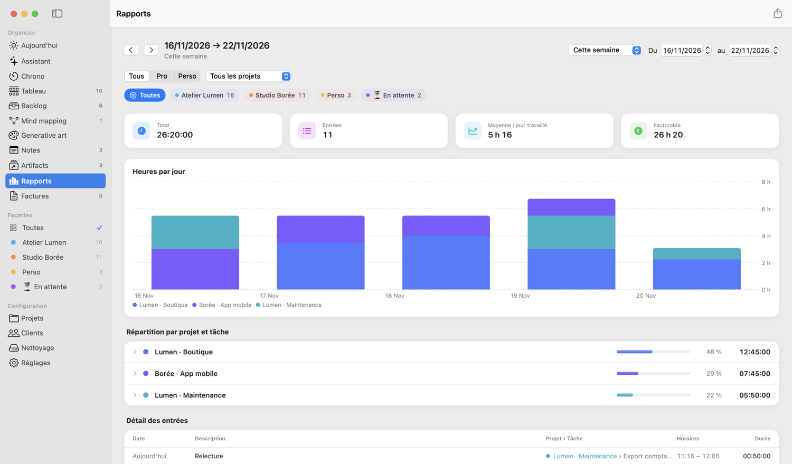
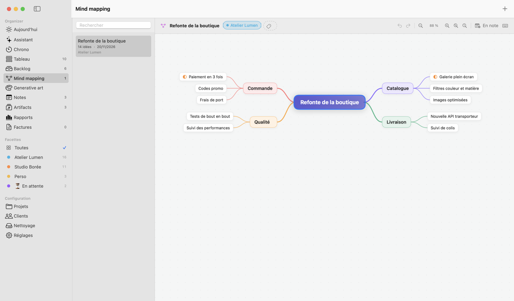
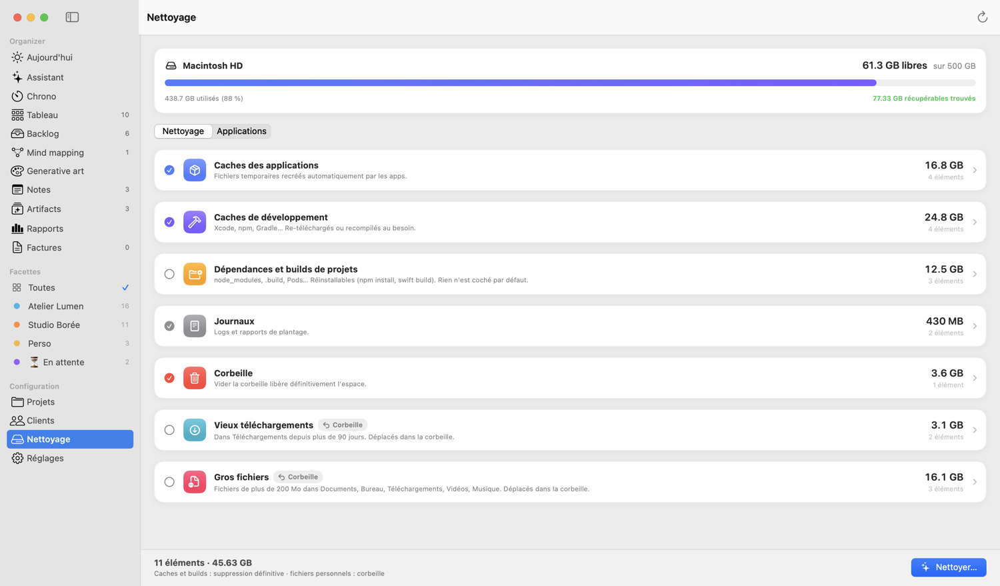
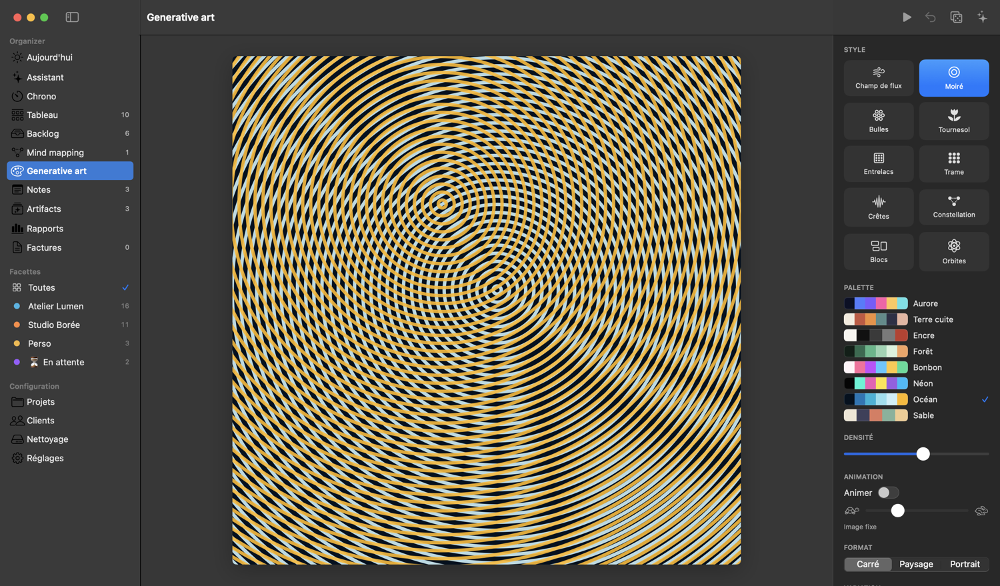
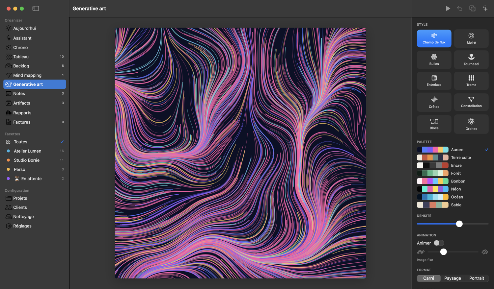

# Organizer

App macOS native (SwiftUI) pour organiser ses tâches pro et perso, suivre son temps et facturer — le tout **en local** : une base SQLite sur ton Mac, aucune donnée envoyée ailleurs que vers les services que tu branches toi-même.



## Ce que fait l'app

**Tâches et temps**

- **Aujourd'hui** : suggestions du jour classées par urgence, et plan de journée généré par un modèle local (Ollama) qui tient compte de ton agenda
- **Tableau** kanban (À faire / En cours / Presque terminé / Terminée) alimenté par un **Backlog**
- **Chrono** avec badge dans la barre de menus, entrées de temps liées aux tâches
- **Rapports** sur n'importe quelle période, par projet, tâche et jour, export CSV
- **Facettes** : un filtre global (par client, par sujet…) qui détermine ce que montre toute l'app

**Notes et idées**

- **Notes** Markdown et **Artifacts** (liens vers des documents), rattachés aux tâches
- **Mind mapping** : cartes mentales au clavier, liées aux tâches et aux notes
- **Assistant** : discussion avec un modèle local qui connaît tes tâches, ton agenda et tes notes, et peut agir (créer une tâche, lancer le chrono…)

**Facturation**

- **Clients**, taux, régimes de TVA ; brouillon de **facture** généré depuis le temps non facturé, export PDF

**Intégrations** (toutes optionnelles, à configurer dans Réglages)

- **Jira** (synchro bidirectionnelle des tickets), **GitLab** (merge requests liées aux tickets), **Clockify** (import)
- **Google Agenda** et **Calendrier Apple**, **Apple Mail** et **Apple Notes** (lecture)
- **Ollama** pour tout ce qui est IA : rien ne quitte ta machine, et il ne se lance que si tu l'actives

**Et aussi**

- **Nettoyage** : caches, builds de projets, gros fichiers, vieux téléchargements, désinstallation d'applications
- **Generative art** : dix styles animables, export PNG ou fond d'écran
- **API REST locale** pour piloter l'app depuis des scripts ou un agent (voir [CLAUDE.md](CLAUDE.md))

## Captures

| | |
|---|---|
|  **Aujourd'hui** — suggestions et plan du jour |  **Chrono** — entrées de temps par jour |
|  **Rapports** — heures par jour et par projet |  **Mind mapping** — idées liées aux tâches |
|  **Nettoyage** — espace récupérable par catégorie |  **Generative art** — style Moiré |



Toutes les captures montrent des données fictives.

## Installation

Nécessite macOS 14+ et Xcode ou Swift 5.10+. Il n'y a pas de projet Xcode : c'est un Swift Package.

```bash
./scripts/build-app.sh            # construit build/Organizer.app
./scripts/build-app.sh --install  # et le copie dans /Applications
swift build                       # build de développement
```

Au premier lancement l'app est vide : crée un projet et une tâche, ou branche Jira / Clockify dans Réglages pour importer l'existant.

## Données et confidentialité

- Données : `~/Library/Application Support/Organizer/organizer.sqlite`
- Réglages (clés d'API, profil, facettes) : préférences macOS de l'app, jamais dans le dépôt
- L'API locale n'écoute que sur `127.0.0.1` et demande un jeton, écrit dans `~/Library/Application Support/Organizer/api.json`

## Mode démo

Pour essayer l'app sans toucher à tes données, ou régénérer les captures :

```bash
swift build
ORGANIZER_DEMO_DIR=/tmp/organizer-demo .build/debug/Organizer   # instance isolée, sans synchronisation
python3 scripts/demo-data.py /tmp/organizer-demo                # la remplit de données fictives
./scripts/screenshots.sh                                        # régénère docs/screenshots
```

## Architecture

Le code est dans `Sources/Organizer` : `Store.swift` (état et persistance), `Database.swift` (SQLite et migrations), `APIServer.swift` + `APIRouter.swift` (API locale), un fichier par intégration, et les écrans dans `Views/`. Le détail est dans [CLAUDE.md](CLAUDE.md).

## Licence

[MIT](LICENSE).
